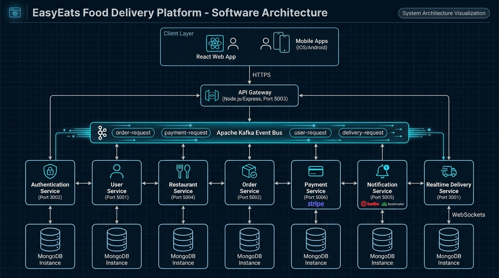
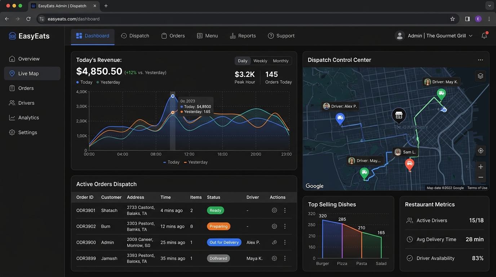
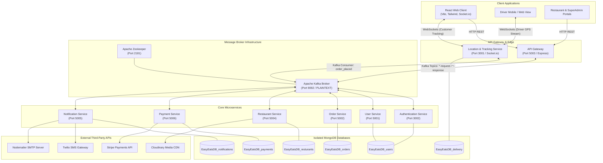
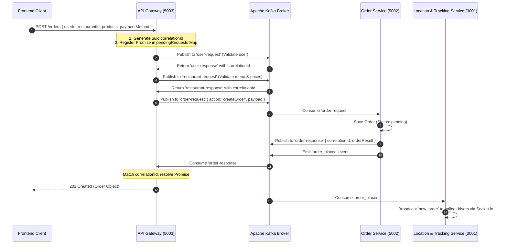

# 🍕 EasyEats Backend — Distributed Event-Driven Microservices Platform

<p align="center">
  
</p>

<p align="center">
  <a href="https://nodejs.org/"></a>
  <a href="https://expressjs.com/"></a>
  <a href="https://kafka.apache.org/"></a>
  <a href="https://www.docker.com/"></a>
  <a href="https://www.mongodb.com/"></a>
  <a href="https://stripe.com/"></a>
  <a href="https://www.twilio.com/"></a>
  <a href="https://socket.io/"></a>
</p>

---

## 📖 System Overview

**EasyEats Backend** is an enterprise-grade, distributed microservices platform engineered for high-volume food delivery operations. Built with **Node.js**, **Express**, and **Apache Kafka**, the system powers seamless interactions among customers, restaurant vendors, logistics delivery drivers, and platform super administrators.

### Core Architecture Highlights
- ⚡ **Asynchronous Event-Driven Messaging**: Decoupled microservice communication mediated by **Apache Kafka** brokers with request-response correlation ID patterns.
- 🌐 **Centralized API Gateway**: Single point of ingress on Port `5003` orchestrating routing, authorization token verification, payload validation, and event dispatching.
- 📍 **Geospatial Proximity Engine**: MongoDB `2dsphere` spatial indexing for millisecond-latency restaurant discovery and nearest-driver dispatch.
- 🛵 **Real-Time Bidirectional Telemetry**: High-frequency WebSocket server powered by **Socket.IO** (Port `3001`) broadcasting driver GPS coordinates directly to tracking maps.
- 💳 **Resilient Payment & Webhook Lifecycle**: Integrated **Stripe** payment processing supporting asynchronous webhooks and automated refunds.
- 📲 **Omnichannel Notification Engine**: Multi-channel alerts using **Nodemailer** (Email receipts) and **Twilio** (SMS driver dispatch alerts).
- 🐳 **Containerized Infrastructure**: Fully containerized ecosystem with single-command deployment via **Docker Compose**.

---

## 🎬 Screen Recording & Platform Demonstration

The backend powers the complete real-time lifecycle of the EasyEats platform, as demonstrated below:

### 📹 Full Platform Walkthrough Recording

<p align="center">
  
</p>
<p align="center"><em>Screen recording capturing end-to-end platform workflows powered by the microservices backend.</em></p>

---

## 📸 Platform Interfaces & System Previews

<div align="center">
  <table>
    <tr>
      <td width="50%" align="center">
        <strong>Customer Ordering & Discovery View</strong><br/><br/>
        
      </td>
      <td width="50%" align="center">
        <strong>Admin Dispatch & Realtime Telemetry</strong><br/><br/>
        
      </td>
    </tr>
    <tr>
      <td width="50%" align="center">
        <strong>Customer Authentication Flow</strong><br/><br/>
        
      </td>
      <td width="50%" align="center">
        <strong>Shopping Cart & Checkout Interface</strong><br/><br/>
        
      </td>
    </tr>
  </table>
</div>

---

## 🏗️ Architectural Blueprint

### System Topology & Microservices Map



---

## ⚙️ Microservices Ecosystem Breakdown

| Service Name | Port | Primary Responsibility | Data Store | Key Integrations |
| :--- | :--- | :--- | :--- | :--- |
| **`api-gateway`** | `5003` | Single entry point, request validation, Kafka request-reply correlation, auth token validation. | Memory / Cache | KafkaJS |
| **`authentication-service`** | `3002` | User sign-in, Bcrypt password hashing, JWT token issuance & claims parsing. | `EasyEatsDB_users` | JWT, Bcrypt |
| **`user-service`** | `5001` | Profile CRUD, delivery address books, user roles (`CUSTOMER`, `RESTAURANT_OWNER`, `DELIVERY_PERSON`, `SUPER_ADMIN`), geospatial driver coordinates. | `EasyEatsDB_users` | MongoDB 2dsphere |
| **`resturant-service`** | `5004` | Restaurant onboarding, menu management, dish category CRUD, live stock toggle, geospatial restaurant radius search. | `EasyEatsDB_resturants` | Cloudinary, MongoDB 2dsphere |
| **`order-service`** | `5002` | Order placement, item validation, order state machine (`pending` ➔ `processing` ➔ `shipped` ➔ `delivered`), history queries. | `EasyEatsDB_orders` | Kafka Event Producer |
| **`payment-service`** | `5006` | Stripe PaymentIntent generation, webhook validation (`whsec_*`), payment transaction logging, refund processing. | `EasyEatsDB_payments` | Stripe API SDK |
| **`notification-service`** | `5005` | Event-driven customer receipts, SMS dispatch notifications, welcome messages. | `EasyEatsDB_notifications` | Twilio SMS, Nodemailer |
| **`location_org`** | `3001` | Real-time bidirectional WebSocket hub for live GPS telemetry, driver dispatch, and customer map streaming. | `EasyEatsDB_delivery` | Socket.IO, Kafka Consumer |

---

## 📡 Kafka Event-Driven Architecture

### Request-Response Correlation Flow

Because HTTP requests require synchronous client responses, the API Gateway implements an **asynchronous request-reply pattern** over Kafka using unique `correlationId` tracking:



### Kafka Topics Catalog

| Topic Name | Producer Service | Consumer Service(s) | Payload Purpose |
| :--- | :--- | :--- | :--- |
| `auth-requests` | `api-gateway` | `authentication-service` | User login verification & credential check |
| `auth-responses` | `authentication-service` | `api-gateway` | JWT token and user authentication profile |
| `user-request` | `api-gateway` | `user-service` | Query user profile, address book, role verification |
| `user-response` | `user-service` | `api-gateway` | User details or error state |
| `restaurant-request` | `api-gateway` | `resturant-service` | Menu validation, restaurant profile, proximity search |
| `restaurant-response` | `resturant-service` | `api-gateway` | Restaurant menu data and operational hours |
| `order-request` | `api-gateway` | `order-service` | Create order, update order status, fetch order list |
| `order-response` | `order-service` | `api-gateway` | Order confirmation payload & database ID |
| `order_placed` | `order-service` | `location_org`, `notification-service` | Trigger delivery dispatch & send customer receipt |
| `payment-request` | `api-gateway` | `payment-service` | Create Stripe intent, check payment status |
| `payment-response` | `payment-service` | `api-gateway` | Stripe clientSecret & transaction ID |
| `notification-request` | `api-gateway` | `notification-service` | Direct SMS / Email dispatch request |
| `delivery-request` | `api-gateway` | `location_org` | Delivery assignment & status queries |
| `delivery-response` | `location_org` | `api-gateway` | Delivery driver details and tracking coordinates |

---

## 🗺️ Geospatial Engine & Real-Time Tracking

The backend implements MongoDB **2dsphere** spatial indexing for high-performance distance queries:

```javascript
// Spatial indexing in Restaurant & User schemas:
RestaurantSchema.index({ position: '2dsphere' });
UserSchema.index({ position: '2dsphere' });

// Finding restaurants within a 5km radius:
const restaurants = await Restaurant.find({
  position: {
    $near: {
      $geometry: { type: 'Point', coordinates: [userLng, userLat] },
      $maxDistance: 5000 // 5km
    }
  }
});
```

### Real-Time Socket.io Events (`location_org`)

```javascript
// Driver connects and identifies:
socket.emit('identify', { userId: driverId, role: 'driver' });

// Driver streams live GPS telemetry:
socket.emit('live_location', {
  driverId,
  orderId,
  latitude: 6.9271,
  longitude: 79.8612
});

// Customer listens to real-time driver coordinates:
socket.on('live_location', (data) => {
  updateDriverMarkerOnMap(data.latitude, data.longitude);
});
```

---

## 📂 Backend Project Directory Structure

```text
EasyEats-backend/
├── docs/
│   └── assets/                        # Screenshots, diagrams, and recordings
│       ├── architecture_diagram.png   # System architecture diagram
│       ├── demo_walkthrough.webp      # Platform screen recording
│       ├── ui_showcase.png            # Customer UI preview
│       ├── admin_dashboard_showcase.png # Admin dashboard preview
│       ├── screenshot_login.png       # Auth login preview
│       └── screenshot_cart.png        # Cart preview
├── docker-compose.yml                 # Master multi-container orchestration
├── api-gateway/                       # Ingress Gateway (Port 5003)
│   ├── src/
│   │   ├── config/                    # Gateway configurations
│   │   ├── middlewares/               # JWT & Error middlewares
│   │   ├── routes/                    # Proxied route controllers (auth, orders, etc.)
│   │   ├── services/                  # Kafka producer & consumer with Correlation IDs
│   │   └── index.js                   # Express server entry point
│   ├── Dockerfile
│   └── package.json
├── authentication-service/            # Auth & JWT issuance (Port 3002)
│   ├── src/
│   │   ├── controller/authController.js
│   │   ├── models/userModel.js
│   │   ├── routes/authRoutes.js
│   │   ├── services/kafkaService.js
│   │   └── index.js
│   ├── Dockerfile
│   └── package.json
├── user-service/                      # User profiles & roles (Port 5001)
│   ├── src/
│   │   ├── controllers/userController.js
│   │   ├── models/userModel.js
│   │   ├── services/kafkaService.js
│   │   └── index.js
│   ├── Dockerfile
│   └── package.json
├── order-service/                     # Orders & State Machine (Port 5002)
│   ├── src/
│   │   ├── controllers/orderController.js
│   │   ├── models/orderModel.js
│   │   ├── services/kafkaProducer.js
│   │   └── index.js
│   ├── Dockerfile
│   └── package.json
├── resturant-service/                 # Restaurants & Menus (Port 5004)
│   ├── src/
│   │   ├── controllers/resturantController.js
│   │   ├── models/resturantModel.js
│   │   ├── services/kafkaService.js
│   │   └── index.js
│   ├── Dockerfile
│   └── package.json
├── payment-service/                   # Stripe Payments & Refunds (Port 5006)
│   ├── src/
│   │   ├── controllers/paymentController.js
│   │   ├── models/paymentModel.js
│   │   ├── routes/paymentRoutes.js
│   │   ├── services/kafkaService.js
│   │   └── index.js
│   ├── Dockerfile
│   └── package.json
├── notification-service/              # Twilio SMS & Nodemailer (Port 5005)
│   ├── src/
│   │   ├── services/emailService.js
│   │   ├── services/smsService.js
│   │   ├── services/kafkaService.js
│   │   └── server.js
│   ├── Dockerfile
│   └── package.json
└── location_org/                      # Realtime GPS & WebSockets (Port 3001)
    ├── config/socket.js               # Socket.io configuration
    ├── controllers/socketController.js # WebSocket event handlers
    ├── kafka/consumer.js              # Kafka consumer for order_placed
    ├── services/socketService.js      # Driver & Customer room routing
    ├── Dockerfile
    └── server.js
```

---

## 🚀 Deployment & Local Setup

### Option 1: One-Click Startup with Docker Compose (Recommended)

Make sure **Docker Desktop** is running, then execute from the `EasyEats-backend` root:

```bash
# Build and start all 9 containers (Zookeeper, Kafka, 7 Services)
docker compose up --build -d

# Verify that all containers are healthy and running
docker compose ps

# Follow logs from all services in real time
docker compose logs -f
```

To shut down the entire stack:
```bash
docker compose down
```

---

### Option 2: Running Services Individually for Local Development

If running outside Docker, start an Apache Kafka broker instance locally on `localhost:9092` (or use Docker for Kafka only):

```bash
# Start Zookeeper and Kafka
docker compose up -d zookeeper kafka
```

Then in separate terminal windows, navigate to each service directory:

```bash
# 1. API Gateway (Port 5003)
cd api-gateway && npm install && npm start

# 2. Authentication Service (Port 3002)
cd ../authentication-service && npm install && npm start

# 3. User Service (Port 5001)
cd ../user-service && npm install && npm start

# 4. Order Service (Port 5002)
cd ../order-service && npm install && npm start

# 5. Restaurant Service (Port 5004)
cd ../resturant-service && npm install && npm start

# 6. Payment Service (Port 5006)
cd ../payment-service && npm install && npm start

# 7. Notification Service (Port 5005)
cd ../notification-service && npm install && npm start

# 8. Real-time Location Service (Port 3001)
cd ../location_org && npm install && npm start
```

---

## 🔑 Environment Variables Specification

The platform utilizes microservice-scoped environment variables. Refer to the table below for configuration:

| Variable | Target Service | Purpose | Sample Value |
| :--- | :--- | :--- | :--- |
| `PORT` | All Services | Service listener port | `5003`, `5001`, `5002`, `5004`, `5005`, `5006`, `3001`, `3002` |
| `KAFKA_BROKER` | All Services | Address of the Kafka broker | `kafka:9092` (Docker) or `localhost:9092` (Local) |
| `JWT_SECRET` | Gateway, Auth | Secret key for signing & verifying JWTs | `your_super_secret_key` |
| `JWT_EXPIRES_IN` | Gateway, Auth | Token validity period | `1h` or `7d` |
| `MONGO_URI` | All Services | MongoDB Atlas connection string | `mongodb+srv://<user>:<pwd>@cluster.mongodb.net/<db>` |
| `STRIPE_SECRET_KEY` | Payment Service | Stripe server-side secret key | `sk_test_...` |
| `STRIPE_WEBHOOK_SECRET`| Payment Service | Stripe signing secret for webhooks | `whsec_...` |
| `CLOUDINARY_CLOUD_NAME`| Restaurant Svc | Cloudinary account cloud name | `your_cloud_name` |
| `CLOUDINARY_API_KEY` | Restaurant Svc | Cloudinary API access key | `your_api_key` |
| `CLOUDINARY_API_SECRET`| Restaurant Svc | Cloudinary API access secret | `your_api_secret` |
| `TWILIO_ACCOUNT_SID` | Notification Svc | Twilio account identifier | `AC4bae37c7...` |
| `TWILIO_AUTH_TOKEN` | Notification Svc | Twilio authentication token | `bba99268...` |
| `TWILIO_PHONE_NUMBER` | Notification Svc | Twilio virtual phone number | `+15868003046` |
| `EMAIL_USER` | Notification Svc | Nodemailer SMTP sender account | `service@easyeats.com` |
| `EMAIL_PASSWORD` | Notification Svc | SMTP application app password | `app_password` |
| `CLIENT_URL` | Location Service | Allowed CORS origin for WebSockets | `http://localhost:5173` |

---

## 🧪 Health Checks & Ingress API Routes

### System Health
```bash
# Check API Gateway Health
curl http://localhost:5003/health
# Response: 200 OK - {"status": "healthy"}
```

### Core REST Endpoints (via API Gateway Port `5003`)

| Method | Endpoint | Description | Protected |
| :--- | :--- | :--- | :--- |
| `POST` | `/auth/login` | Authenticate user, receive JWT & user profile | ❌ No |
| `POST` | `/users/register` | Register customer, driver, or restaurant owner | ❌ No |
| `GET` | `/users/:id` | Fetch user profile and saved addresses | ✅ Yes |
| `GET` | `/restaurants` | List restaurants with optional geo-filtering | ❌ No |
| `GET` | `/restaurants/:id` | Fetch restaurant details and categorized menu | ❌ No |
| `POST` | `/restaurants` | Onboard and create a new restaurant profile | ✅ Yes (Owner) |
| `POST` | `/orders` | Place a new customer food order | ✅ Yes (Customer) |
| `GET` | `/orders/user/:userId`| Fetch user's order history | ✅ Yes |
| `GET` | `/orders/restaurant/:id`| Fetch active tickets for restaurant kitchen | ✅ Yes (Owner) |
| `PUT` | `/orders/:id/status`| Update order state (`processing`, `shipped`, etc.)| ✅ Yes (Owner/Driver) |
| `POST` | `/payments/create-intent`| Create Stripe PaymentIntent for cart checkout | ✅ Yes |
| `POST` | `/payments/webhook` | Stripe asynchronous webhook confirmation | ❌ Stripe Signature |
| `POST` | `/notifications/sms` | Dispatch transactional SMS via Twilio | ✅ Yes |

---

## 📄 License & Attribution

This project is part of the **EasyEats Distributed Platform**.  
Licensed under the **MIT License**.
