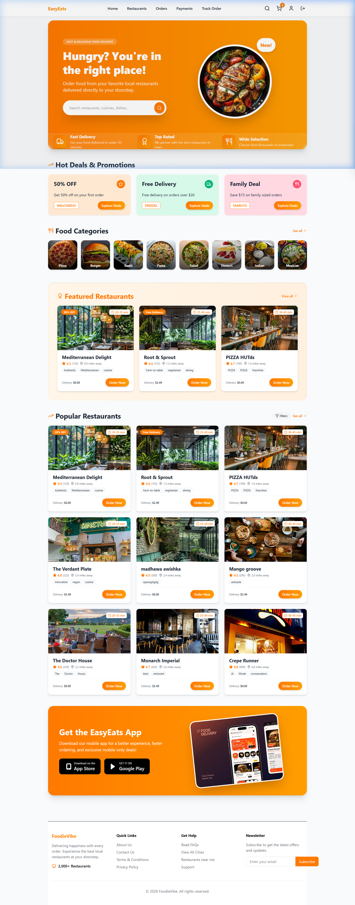
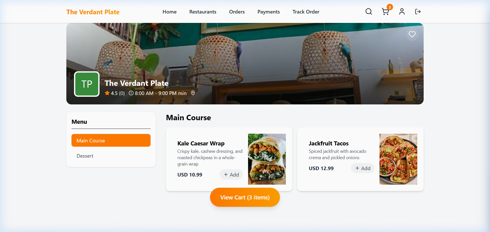
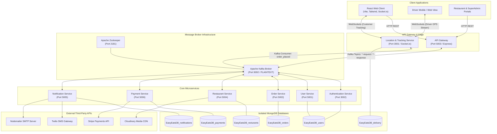
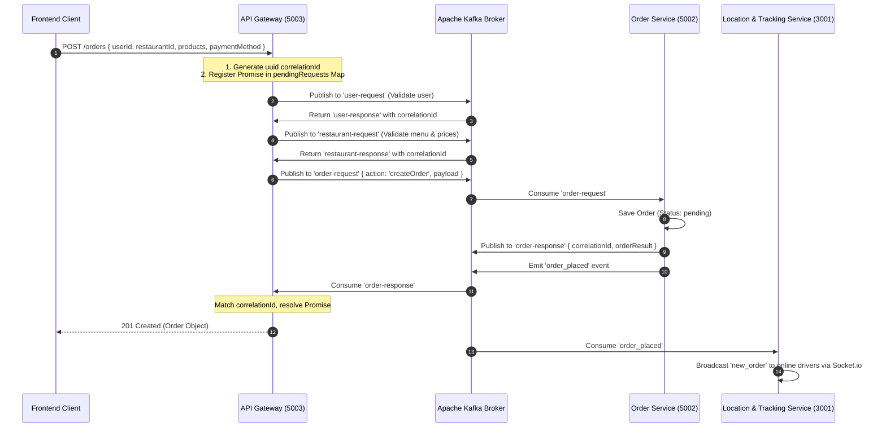

# 🍕 EasyEats Backend — Distributed Event-Driven Microservices Platform

<p align="center">
  
</p>

<p align="center">
  <a href="https://nodejs.org/"></a>
  <a href="https://expressjs.com/"></a>
  <a href="https://kafka.apache.org/"></a>
  <a href="https://www.docker.com/"></a>
  <a href="https://www.mongodb.com/"></a>
  <a href="https://stripe.com/"></a>
  <a href="https://www.twilio.com/"></a>
  <a href="https://socket.io/"></a>
</p>

---

## 📌 Table of Contents
- [📖 System Overview](#-system-overview)
- [🔑 Verified Demo & Testing Accounts](#-verified-demo--testing-accounts)
- [🎬 Screen Recording & Platform Demonstration](#-screen-recording--platform-demonstration)
- [📸 Real Production Screenshots](#-real-production-screenshots)
- [🏗️ Architectural Blueprint](#️-architectural-blueprint)
- [⚙️ Microservices Ecosystem Breakdown](#️-microservices-ecosystem-breakdown)
- [📡 Kafka Event-Driven Architecture](#-kafka-event-driven-architecture)
- [🗺️ Geospatial Engine & Real-Time Tracking](#️-geospatial-engine--real-time-tracking)
- [📂 Backend Project Directory Structure](#-backend-project-directory-structure)
- [🚀 Deployment & Local Setup](#-deployment--local-setup)
- [🔑 Environment Variables Specification](#-environment-variables-specification)
- [🧪 Health Checks & Ingress API Routes](#-health-checks--ingress-api-routes)

---

## 📖 System Overview

**EasyEats Backend** is a high-throughput, distributed microservices platform engineered for enterprise food delivery and on-demand logistics. Built with **Node.js**, **Express**, and **Apache Kafka**, the backend powers the entire transactional and real-time lifecycle between customers, restaurants, delivery drivers, and platform administrators.

### Core Architecture Highlights
- ⚡ **Asynchronous Event-Driven Bus**: Decoupled microservice communication mediated by an **Apache Kafka** broker with request-response correlation ID patterns.
- 🌐 **Centralized API Gateway**: Single point of ingress on Port `5003` orchestrating routing, JWT authentication validation, request validation, and event dispatching.
- 📍 **Geospatial Proximity Engine**: MongoDB `2dsphere` spatial indexing for millisecond-latency restaurant discovery and nearest-driver dispatch.
- 🛵 **Real-Time Bidirectional Telemetry**: High-frequency WebSocket server powered by **Socket.IO** (Port `3001`) broadcasting driver GPS coordinates directly to tracking maps.
- 💳 **Resilient Payment & Webhook Lifecycle**: Integrated **Stripe** payment processing supporting asynchronous webhooks and automated refunds.
- 📲 **Omnichannel Notification Engine**: Multi-channel alerts using **Nodemailer** (Email receipts) and **Twilio** (SMS driver dispatch alerts).
- 🐳 **Containerized Infrastructure**: Fully containerized ecosystem with single-command deployment via **Docker Compose**.

---

## 🔑 Verified Demo & Testing Accounts

The following verified accounts exist in the production database and can be used for API testing or frontend authentication:

| Persona | Email | Password | Role Key | Test Capabilities |
| :--- | :--- | :--- | :--- | :--- |
| 🧑‍🍳 **Customer** | `madhawaawishka@gmail.com` | `Madhawa123` | `CUSTOMER` | Places orders, tests Stripe payment intents, and initiates live tracking |
| 🛵 **Delivery Person** | `john@gmail.com` | `Madhawa123` | `DELIVERY_PERSON` | Connects via WebSocket to receive dispatches and stream GPS telemetry |

---

## 🎬 Screen Recording & Platform Demonstration

Watch the backend microservices handle live authentication, restaurant queries, cart modifications, and real-time WebSocket map tracking:

<p align="center">
  
</p>
<p align="center"><em>Authentic screen recording demonstrating real backend operations: Kafka event routing, MongoDB Atlas queries, and WebSocket streaming.</em></p>

---

## 📸 Real Production Screenshots

<div align="center">
  <table>
    <tr>
      <td width="50%" align="center">
        <strong>🛒 Newly Refined Shopping Cart UI</strong><br/>
        <em>Live item calculations, promo discounts & checkout</em><br/><br/>
        
      </td>
      <td width="50%" align="center">
        <strong>🍽️ Real Restaurant Catalog (Customer View)</strong><br/>
        <em>Live data fetched from MongoDB `EasyEatsDB_resturants`</em><br/><br/>
        
      </td>
    </tr>
    <tr>
      <td width="50%" align="center">
        <strong>📋 Restaurant Menu & Dish Catalog</strong><br/>
        <em>Dish items, Cloudinary media & price records</em><br/><br/>
        
      </td>
      <td width="50%" align="center">
        <strong>🗺️ Customer Live GPS Delivery Map</strong><br/>
        <em>Socket.IO real-time location stream on Leaflet map</em><br/><br/>
        
      </td>
    </tr>
    <tr>
      <td width="50%" align="center">
        <strong>🛵 Delivery Driver Dispatch Radar</strong><br/>
        <em>Real-time driver location broadcast and ticket claiming</em><br/><br/>
        
      </td>
      <td width="50%" align="center">
        <strong>📊 Restaurant & Dispatch Analytics</strong><br/>
        <em>Sales revenue charts, active tickets & fleet stats</em><br/><br/>
        
      </td>
    </tr>
  </table>
</div>

---

## 🏗️ Architectural Blueprint

### Master System Topology



---

## ⚙️ Microservices Ecosystem Breakdown

| Service Name | Port | Primary Responsibility | Data Store | Key Integrations |
| :--- | :--- | :--- | :--- | :--- |
| **`api-gateway`** | `5003` | Single entry point, request validation, Kafka request-reply correlation, auth token validation. | In-Memory Routing | KafkaJS |
| **`authentication-service`** | `3002` | User sign-in, Bcrypt password hashing, JWT token issuance & claims parsing. | `EasyEatsDB_users` | JWT, Bcrypt |
| **`user-service`** | `5001` | Profile CRUD, delivery address books, user roles (`CUSTOMER`, `RESTAURANT_OWNER`, `DELIVERY_PERSON`, `SUPER_ADMIN`), geospatial driver coordinates. | `EasyEatsDB_users` | MongoDB 2dsphere |
| **`resturant-service`** | `5004` | Restaurant onboarding, menu management, dish category CRUD, live stock toggle, geospatial restaurant radius search. | `EasyEatsDB_resturants` | Cloudinary, MongoDB 2dsphere |
| **`order-service`** | `5002` | Order placement, item validation, order state machine (`pending` ➔ `processing` ➔ `shipped` ➔ `delivered`), history queries. | `EasyEatsDB_orders` | Kafka Event Producer |
| **`payment-service`** | `5006` | Stripe PaymentIntent generation, webhook validation (`whsec_*`), payment transaction logging, refund processing. | `EasyEatsDB_payments` | Stripe API SDK |
| **`notification-service`** | `5005` | Event-driven customer receipts, SMS dispatch notifications, welcome messages. | `EasyEatsDB_notifications` | Twilio SMS, Nodemailer |
| **`location_org`** | `3001` | Real-time bidirectional WebSocket hub for live GPS telemetry, driver dispatch, and customer map streaming. | `EasyEatsDB_delivery` | Socket.IO, Kafka Consumer |

---

## 📡 Kafka Event-Driven Architecture

### Request-Response Correlation Flow

Because HTTP requests require synchronous client responses, the API Gateway implements an **asynchronous request-reply pattern** over Kafka using unique `correlationId` tracking:



### Kafka Topics Catalog

| Topic Name | Producer Service | Consumer Service(s) | Payload Purpose |
| :--- | :--- | :--- | :--- |
| `auth-requests` | `api-gateway` | `authentication-service` | User login verification & credential check |
| `auth-responses` | `authentication-service` | `api-gateway` | JWT token and user authentication profile |
| `user-request` | `api-gateway` | `user-service` | Query user profile, address book, role verification |
| `user-response` | `user-service` | `api-gateway` | User details or error state |
| `restaurant-request` | `api-gateway` | `resturant-service` | Menu validation, restaurant profile, proximity search |
| `restaurant-response` | `resturant-service` | `api-gateway` | Restaurant menu data and operational hours |
| `order-request` | `api-gateway` | `order-service` | Create order, update order status, fetch order list |
| `order-response` | `order-service` | `api-gateway` | Order confirmation payload & database ID |
| `order_placed` | `order-service` | `location_org`, `notification-service` | Trigger delivery dispatch & send customer receipt |
| `payment-request` | `api-gateway` | `payment-service` | Create Stripe intent, check payment status |
| `payment-response` | `payment-service` | `api-gateway` | Stripe clientSecret & transaction ID |
| `notification-request` | `api-gateway` | `notification-service` | Direct SMS / Email dispatch request |
| `delivery-request` | `api-gateway` | `location_org` | Delivery assignment & status queries |
| `delivery-response` | `location_org` | `api-gateway` | Delivery driver details and tracking coordinates |

---

## 🗺️ Geospatial Engine & Real-Time Tracking

The backend implements MongoDB **2dsphere** spatial indexing for high-performance distance queries:

```javascript
// Spatial indexing in Restaurant & User schemas:
RestaurantSchema.index({ position: '2dsphere' });
UserSchema.index({ position: '2dsphere' });

// Finding restaurants within a 5km radius:
const restaurants = await Restaurant.find({
  position: {
    $near: {
      $geometry: { type: 'Point', coordinates: [userLng, userLat] },
      $maxDistance: 5000 // 5km
    }
  }
});
```

---

## 📂 Backend Project Directory Structure

```text
EasyEats-backend/
├── docs/assets/                       # Shared media, recordings & screenshots
│   ├── architecture_diagram.png       # Master architecture infographic
│   ├── demo_walkthrough.webp          # Full platform animated screen recording
│   ├── screenshot_cart.png            # Newly refined Cart UI screenshot
│   ├── screenshot_customer_home.png   # Real fetched restaurant catalog
│   ├── screenshot_restaurant_menu.png # Restaurant menu & dishes
│   ├── screenshot_customer_tracking.png # Real customer live Leaflet map
│   └── screenshot_driver_map.png      # Delivery driver radar & map
├── docker-compose.yml                 # Master multi-container orchestration
├── api-gateway/                       # Ingress Gateway (Port 5003)
│   ├── src/routes/                    # Proxied route controllers (auth, orders, etc.)
│   ├── src/services/kafkaService.js   # Kafka producer/consumer with Correlation IDs
│   └── src/index.js                   # Gateway server entry point
├── authentication-service/            # Auth & JWT issuance (Port 3002)
├── user-service/                      # User profiles & roles (Port 5001)
├── order-service/                     # Orders & State Machine (Port 5002)
├── resturant-service/                 # Restaurants & Menus (Port 5004)
├── payment-service/                   # Stripe Payments & Refunds (Port 5006)
├── notification-service/              # Twilio SMS & Nodemailer (Port 5005)
└── location_org/                      # Realtime GPS & WebSockets (Port 3001)
```

---

## 🚀 Deployment & Local Setup

### Option 1: One-Click Startup with Docker Compose (Recommended)

Make sure **Docker Desktop** is running, then execute from the `EasyEats-backend` root:

```bash
# Build and start all 9 containers (Zookeeper, Kafka, 7 Services)
docker compose up --build -d

# Verify that all containers are healthy and running
docker compose ps

# Follow logs from all services in real time
docker compose logs -f
```

To shut down the entire stack:
```bash
docker compose down
```

---

## 🔑 Environment Variables Specification

| Variable | Target Service | Purpose | Sample Value |
| :--- | :--- | :--- | :--- |
| `PORT` | All Services | Service listener port | `5003`, `5001`, `5002`, `5004`, `5005`, `5006`, `3001`, `3002` |
| `KAFKA_BROKER` | All Services | Address of the Kafka broker | `kafka:9092` (Docker) or `localhost:9092` (Local) |
| `JWT_SECRET` | Gateway, Auth | Secret key for signing & verifying JWTs | `your_super_secret_key` |
| `JWT_EXPIRES_IN` | Gateway, Auth | Token validity period | `1h` or `7d` |
| `MONGO_URI` | All Services | MongoDB Atlas connection string | `mongodb+srv://<user>:<pwd>@cluster.mongodb.net/<db>` |
| `STRIPE_SECRET_KEY` | Payment Service | Stripe server-side secret key | `sk_test_...` |
| `STRIPE_WEBHOOK_SECRET`| Payment Service | Stripe signing secret for webhooks | `whsec_...` |
| `CLOUDINARY_CLOUD_NAME`| Restaurant Svc | Cloudinary account cloud name | `your_cloud_name` |
| `CLOUDINARY_API_KEY` | Restaurant Svc | Cloudinary API access key | `your_api_key` |
| `CLOUDINARY_API_SECRET`| Restaurant Svc | Cloudinary API access secret | `your_api_secret` |
| `TWILIO_ACCOUNT_SID` | Notification Svc | Twilio account identifier | `AC4bae37c7...` |
| `TWILIO_AUTH_TOKEN` | Notification Svc | Twilio authentication token | `bba99268...` |
| `TWILIO_PHONE_NUMBER` | Notification Svc | Twilio virtual phone number | `+15868003046` |
| `EMAIL_USER` | Notification Svc | Nodemailer SMTP sender account | `service@easyeats.com` |
| `EMAIL_PASSWORD` | Notification Svc | SMTP application app password | `app_password` |
| `CLIENT_URL` | Location Service | Allowed CORS origin for WebSockets | `http://localhost:5173` |

---

## 🧪 Health Checks & Ingress API Routes

### 1. Test Gateway Health
```bash
curl http://localhost:5003/health
# Output: API Gateway is healthy
```

### 2. Test Customer Authentication with Demo Account
```bash
curl -X POST http://localhost:5003/auth/login \
  -H "Content-Type: application/json" \
  -d '{"email":"madhawaawishka@gmail.com","password":"Madhawa123"}'
```

### 3. Fetch Real Restaurant Catalog
```bash
curl http://localhost:5003/restaurants
```

---

## 📄 License & Attribution

This project is part of the **EasyEats Distributed Platform**.  
Licensed under the **MIT License**.
